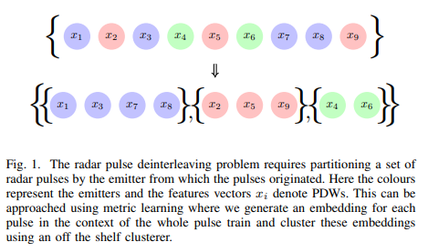
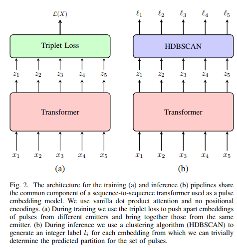
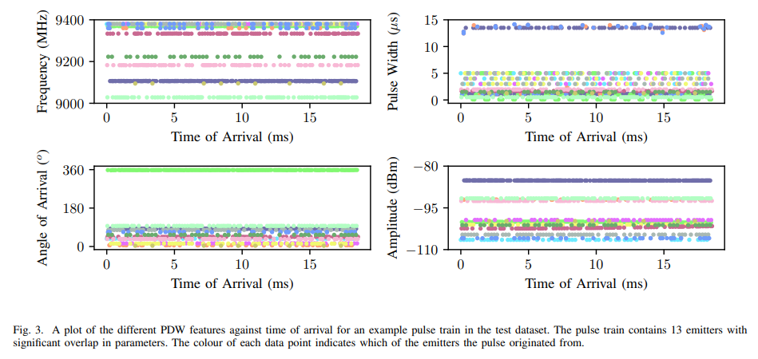
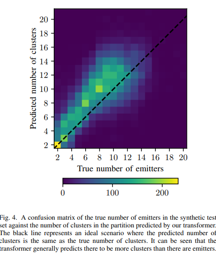
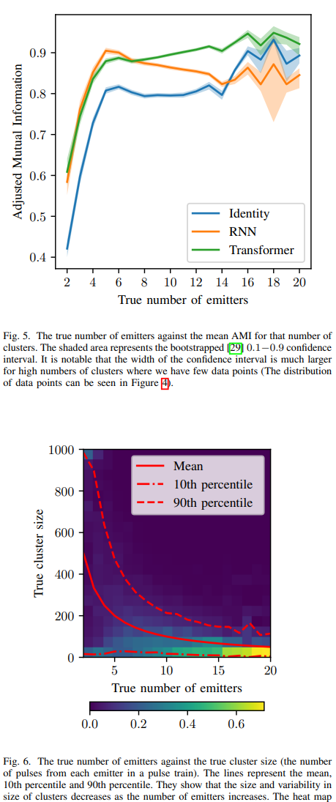

# Radar Signal Processing: Radar Pulse Deinterleave Method Based on Transformer-based Deep Metric Learning [with Python Code]

In the case of receiving radar pulses, the recorded sequence of pulses typically contains pulses from multiple different radiation sources. The task of de-interleaving radar pulses refers to the task of separating these pulses according to their original radiation source. It is important to note that the number of radiation sources in any specific recorded sequence is considered unknown. In this paper, we define the problem and propose metrics for measuring model performance. We present a metric learning approach to addressing this problem using a Transformer model trained on synthetic data via triplet loss. Compared to other deep learning models, this model achieves outstanding results with an adjusted mutual information score of 0.882.
The article includes illustrations.
Conclusion: In this paper, we define the problem of de-interleaving and propose a metric learning approach as a solution. This approach uses a Transformer model trained on synthetic data via triplet loss. We show that compared to the identity baseline, this method achieves excellent results, indicating its effectiveness in solving the de-interleaving problem. Additionally, we demonstrate that the Transformer architecture outperforms the GRU architecture commonly used in literature within this pipeline. Future work on the Transformer within this pipeline can further improve de-interleaving performance.
End

## Images

<!-- PAYMENT_BLOCK -->

## Get this dataset

- Payment link (Stripe): [Buy now](https://buy.stripe.com/3cs8yP7sY87d0vu9AB)
- Payment QR code: 

<!-- /PAYMENT_BLOCK -->
